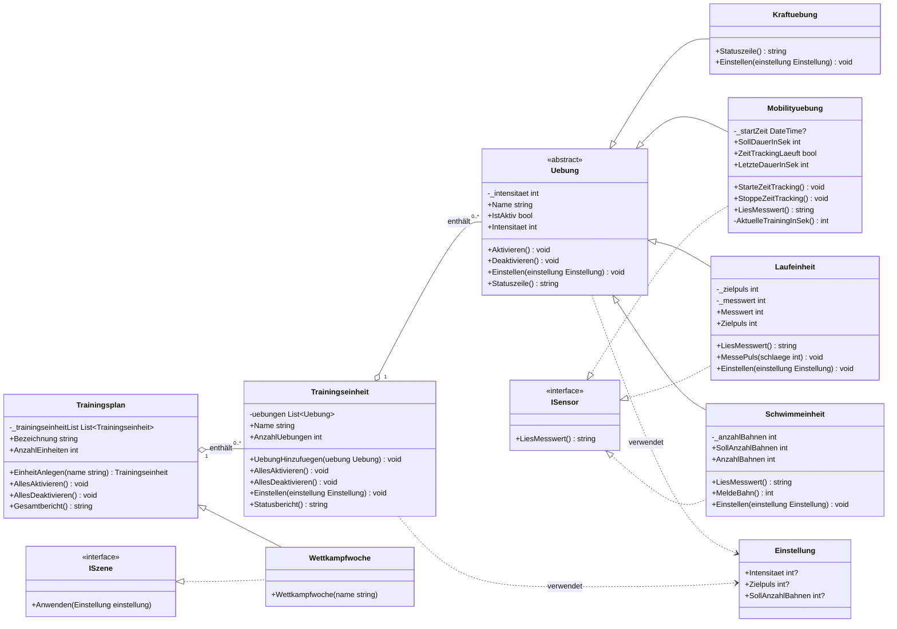

# Klassendiagramm — ActiveLog 2.0

Das ist der **Bauplan** deines Systems. Halte ihn nach jeder Story aktuell
(Definition of Done) — so wie es die Projektdokumentation bei FitConnect verlangt.

Zeichne als ASCII-Skizze direkt hier hinein oder verlinke ein Foto/Export
(z. B. `docs/klassendiagramm.png`), wenn du lieber auf Papier oder mit einem
Tool zeichnest.

## Notations-Spickzettel

```
+-------------------------+       +  public
| Kraftuebung             |       -  private
+-------------------------+       #  protected
| - intensitaet: int      |
+-------------------------+       Vererbung:      Kind ----|> Basisklasse
| + Aktivieren(): void    |       Interface:      Klasse ..|> ISchnittstelle
| + Statuszeile(): string |       Aggregation:    Ganzes o--- Teil
+-------------------------+       Komposition:    Ganzes *--- Teil
```

## Dein Diagramm (Stand: Story 08)
# Klassendiagramm

